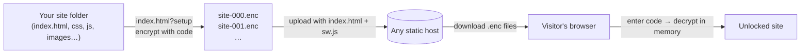
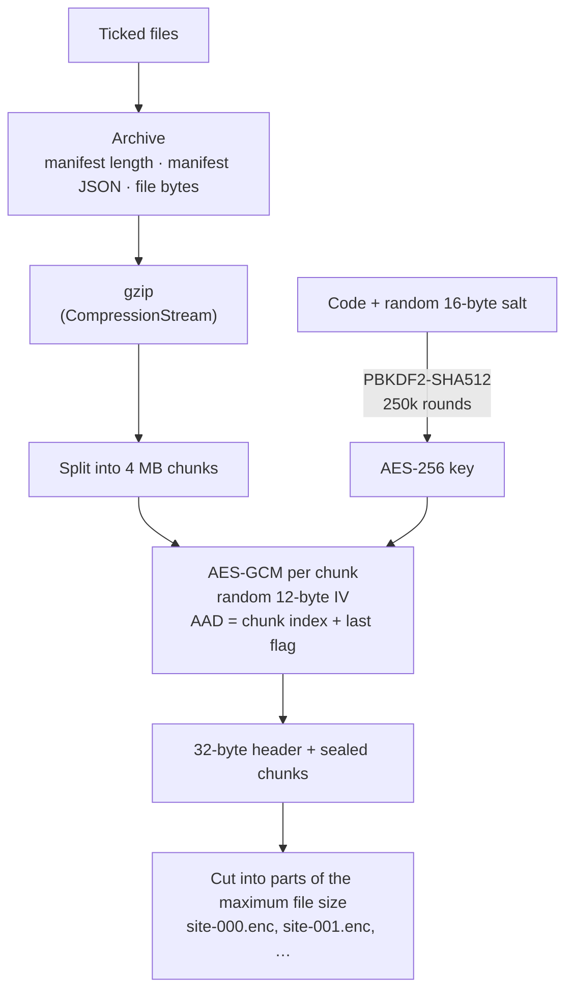
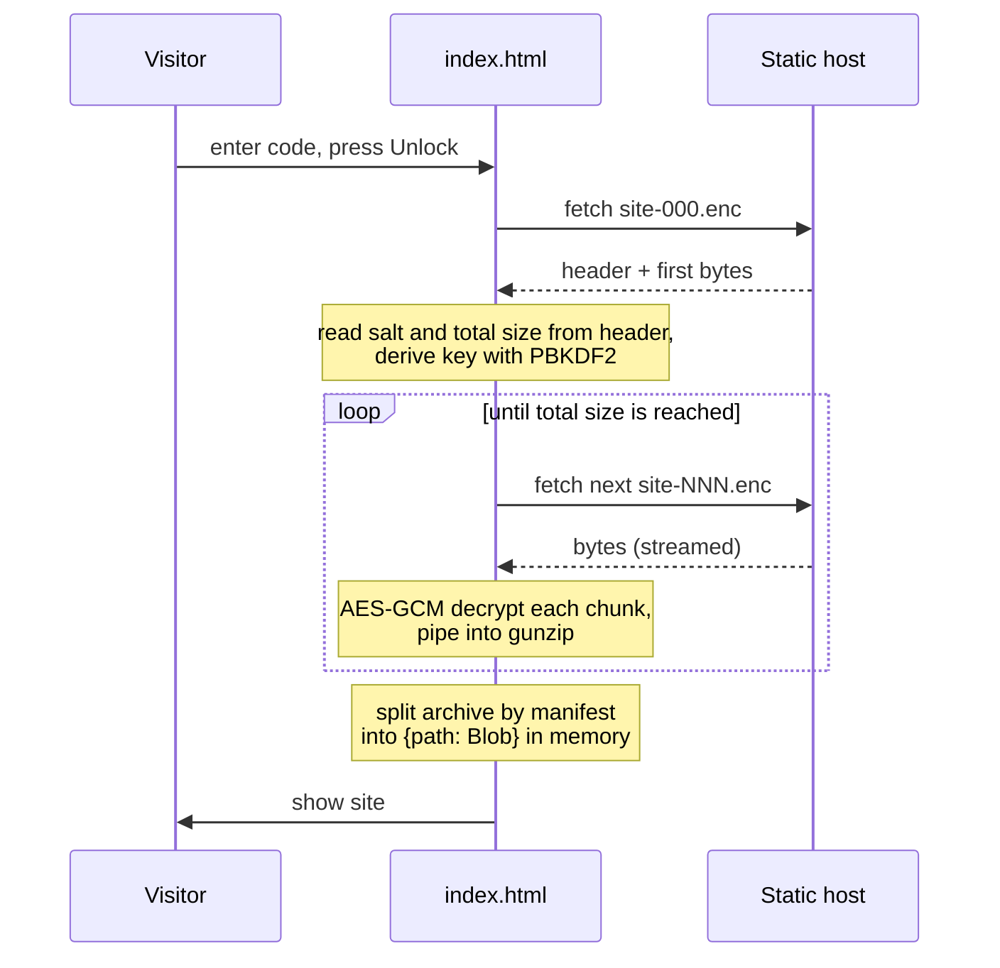
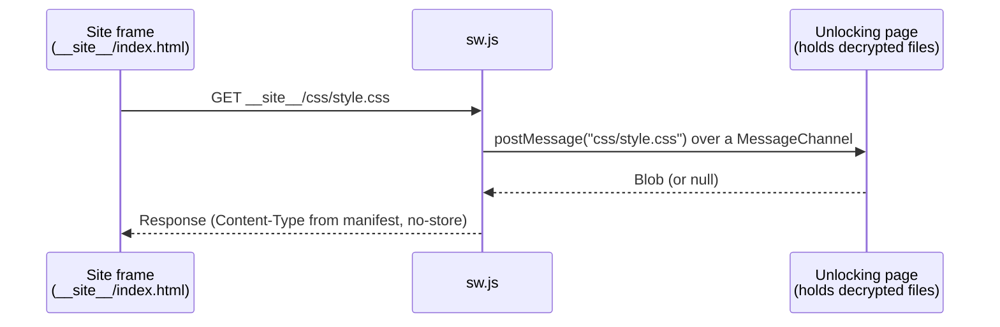

<p align="center">
  
</p>

# locked-static-page

Put a static website behind an access code. The site is encrypted in your browser and published as
numbered files. Visitors enter the code, and the site is decrypted and opened in their browser.
Nothing is decrypted on the server.



## Lock a site

1. Open `index.html?setup`
2. Pick the site's folder. It needs an `index.html` at its top level.
3. Untick any files you don't want to include. Hidden files start unticked.
4. Press **Generate**, then **Copy**, and keep the code somewhere safe. It can't be recovered.
5. Set **Maximum file size** (20 MB by default; Cloudflare Pages serves files of up to 25 MB).
6. Press **Encrypt and save**. You get `site-000.enc`, `site-001.enc` and so on, each at most that size.

## Publish it

Put these files together on any static host:

```
index.html
sw.js
site-000.enc
site-001.enc
...
```

Don't publish the original folder.

## Open it

Visitors open `index.html`, enter the code and press **Unlock**. The page downloads the `.enc`
files, decrypts them, and shows the site.

## How it works

The whole tool is two files with no dependencies and no build step: `index.html` (the setup screen, the
unlock screen and all the crypto) and `sw.js` (a service worker that serves the unlocked files). Everything
runs on standard browser APIs:

| Job | Browser API |
| --- | --- |
| Key derivation | Web Crypto `PBKDF2` (SHA-512, 250,000 iterations) |
| Encryption | Web Crypto `AES-GCM` with a 256-bit key |
| Compression | `CompressionStream` / `DecompressionStream` (gzip) |
| Random salt, IVs and codes | `crypto.getRandomValues` |
| Reading the site folder | `<input type="file" webkitdirectory>` |
| Saving the parts | File System Access API (`showDirectoryPicker`), or one download per part where it isn't supported |
| Downloading the parts | `fetch` with streamed bodies (`ReadableStream`) |
| Serving the unlocked site | Service worker + `MessageChannel` |

Because Web Crypto and service workers need a secure context, the page only works over HTTPS or on
`localhost`.

### Encrypting



1. **Archive.** The ticked files are joined into one archive: a JSON manifest listing each file's path,
   size and MIME type, followed by the raw bytes of every file in manifest order.
2. **Compress.** The archive is streamed through gzip.
3. **Derive the key.** A random 16-byte salt and the code go through PBKDF2-SHA512 (250,000 rounds) to
   produce an AES-256-GCM key. The slow derivation makes guessing codes expensive. Generated codes are
   32 characters from a 64-character alphabet (192 bits of randomness); typed codes must be at least 20
   characters.
4. **Encrypt in chunks.** The compressed stream is cut into 4 MB chunks, and each is sealed with AES-GCM
   under its own random IV. The chunk's index and an "is last" flag are bound in as additional
   authenticated data, so chunks can't be reordered, swapped between sites, or truncated without
   decryption failing.
5. **Split for hosting.** The result is cut into parts of the chosen maximum size and saved as
   `site-NNN.enc`. Part boundaries are independent of chunk boundaries, since parts are just byte ranges of
   one encrypted file.

### File format

Concatenating the parts in order gives one encrypted file:

```
┌──────────────────────────── header (32 bytes) ────────────────────────────┐
│ "LCK1" (4) │ salt (16) │ chunk size, uint32 (4) │ total size, float64 (8) │
└───────────────────────────────────────────────────────────────────────────┘
┌─────────── chunk 0 ───────────┐┌─────────── chunk 1 ───────────┐
│ IV (12) │ ciphertext + tag(16)││ IV (12) │ ciphertext + tag(16)│ …
└───────────────────────────────┘└───────────────────────────────┘
```

Decrypted and gunzipped, the chunks give back the archive:

```
manifest length, uint32 (4) │ manifest JSON [{path, size, type}, …] │ file 1 bytes │ file 2 bytes │ …
```

### Unlocking



The parts are fetched in order as one stream until the total size from the header is reached, so the
unlocking page doesn't need to know how many parts there are or how big each one is. Each chunk is
decrypted as soon as it arrives. If the first chunk fails to authenticate, the code is wrong; if a later
one fails, the files are damaged or incomplete.

### Showing the unlocked site

The decrypted files are kept only as `Blob`s in the unlocking page's memory. Nothing is written to disk
or to the browser cache, and the files are gone when the tab closes.



After unlocking, `index.html` registers `sw.js` and loads the site in a full-page iframe at
`__site__/index.html`. The service worker intercepts every request under `__site__/`, asks the unlocking
page for the file at that path, and answers with it (or a 404). To the site, it looks like it's being
served normally from a real folder, so relative links, CSS `url()`, `fetch()`, ES modules and paths built in
JavaScript all work.

**Without `sw.js`** (missing file or a browser without service workers), the page falls back to replacing
itself with the site's `index.html`, after rewriting the quoted references in it (`"style.css"`,
`'./app.js'`) to `blob:` URLs of the decrypted files. Only references written directly in `index.html`
load this way; references inside other files, such as CSS `url()` or imports in scripts, don't.

## Good to know

- Anyone with the code can see and save every file in the site.
- The protection is only as strong as the code. Use **Generate** rather than something guessable.
- The `.enc` files are public and can be downloaded and attacked offline, so a weak code can be brute-forced.
- Links that start with `/` (like `/about.html`) don't work. Use relative links (`about.html`).
- A new code means encrypting again and publishing the new `.enc` files.
- The whole site is decrypted into memory, so very large sites need a visitor with enough RAM.

## Local Decryption Test
To test the decryption locally, you can use the following options:

#### Option 1: Python
```
python -m http.server 6060
```

#### Option 2: npx
```
npx serve -l 6060
```

Then go to localhost:6060 and paste your code to see the page.
